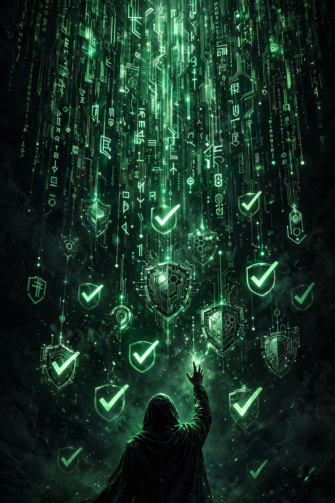

# Zion

**Public infrastructure for trust in agents.** The eval layer for the long-horizon era.

Every repo here answers one question: **how do I know I am right?**

Commercial eval vendors sell SaaS dashboards. Nobody owns the open, adversarial, public verification layer. We are building it. Our differentiator is checkable: every rule is wired to a running hook. **Prose is not enforcement.**

## The family

| Repo | One line |
|---|---|
| [agentgate](https://github.com/Zion-sewers/agentgate) | Calibrated selective verification: solver → judge → conformal gate. CONFIRMED / REFUTED / ABSTAINED with statistical risk bounds. |
| [mcp-guard](https://github.com/Zion-sewers/mcp-guard) | Adversarial fuzzer for MCP servers. Break your tools before attackers do. |
| [agenteval-bench](https://github.com/Zion-sewers/agenteval-bench) | pytest for agent outputs. Deterministic matchers, regression tracking, CI gates. |
| [protobuf-fuzz-guard](https://github.com/Zion-sewers/protobuf-fuzz-guard) | Protobuf schema CVE scanning plus fuzz-harness generation in four languages. |
| [sqltok](https://github.com/Zion-sewers/sqltok) | Token-budgeted schema selection for Text-to-SQL. |
| [claude-setup](https://github.com/Zion-sewers/claude-setup) | A personal agent OS you can inspect. |
| [claude-memes-skills](https://github.com/Zion-sewers/claude-memes-skills) | The fun surface: event-driven meme GIFs for Claude Code. |

## Doctrine

- Verdict first, mechanism after.
- Every public number carries its receipt.
- Adversarial-honest: every README has an honest-limits section.
- No counter = invisible = no pride.

## Follow the work

- Kanban: the Zion project board is the system of record.
- Releases ship with runnable demos. No demo, no release.
